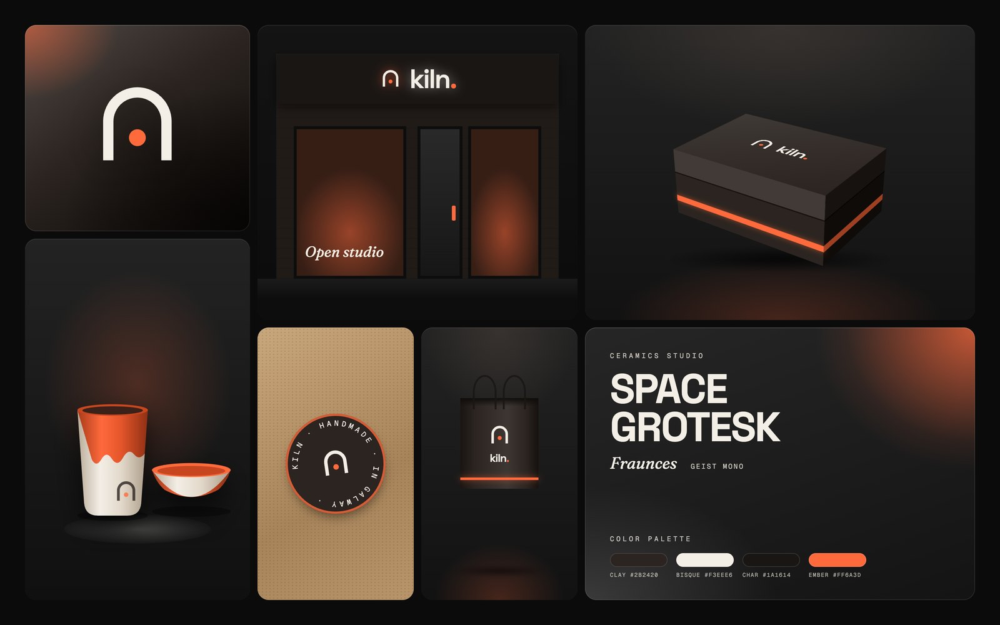
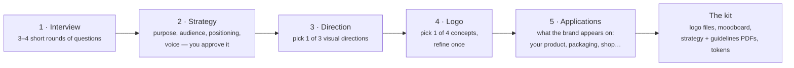
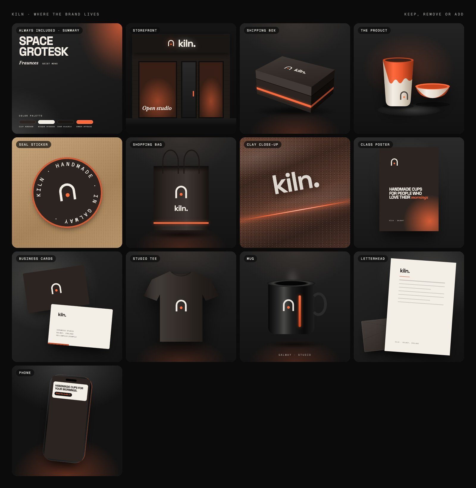
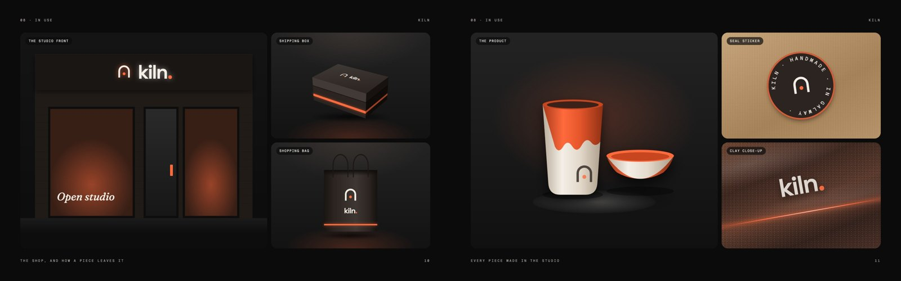
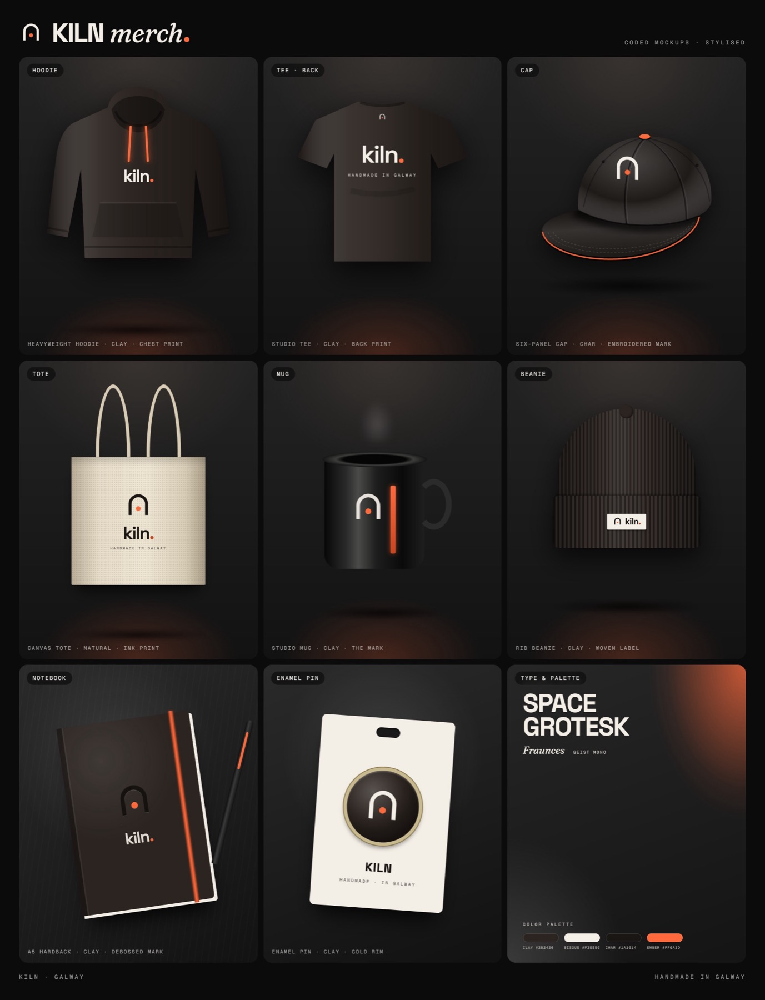
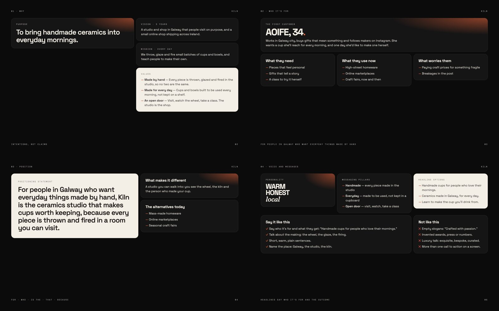
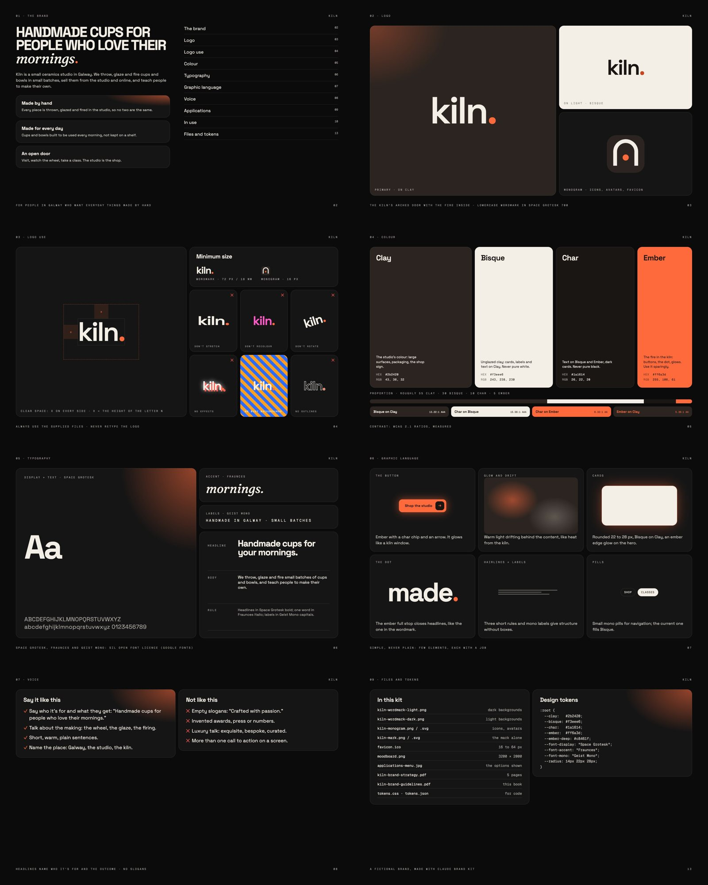
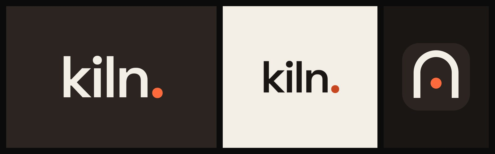

<p align="center">
  
</p>

<h1 align="center">Claude Brand Kit</h1>

<p align="center">
  <b>Four Claude Code skills that turn an idea into a finished brand.</b><br />
  Strategy, logo, moodboard, brand guidelines and design tokens — drawn in code, rendered on your own machine.
</p>

<p align="center">
  <code>/brand-identity</code> · <code>/brand-kit</code> · <code>/moodboard</code> · <code>/logo</code> · <code>/merch-mockup</code>
</p>

---

## What it does

| Command | For | You get |
|---|---|---|
| **`/brand-identity`** | You have an idea, but no brand yet | Claude interviews you about your vision, goals, audience and personality, writes the strategy, shows you **3 visual directions** and **4 logo concepts** to choose from, then builds the whole kit below |
| **`/brand-kit`** | You already have a name, logo or colours | Logo files, a moodboard, a **brand guidelines PDF** with the brand on your own products, packaging and signage, a cover image, `tokens.css` / `tokens.json` and a README |
| **`/moodboard`** | A quick visual of the brand | A **7-tile moodboard** of the brand on the things your business really makes and uses, 3200 × 2000 PNG |
| **`/logo`** | Logo files for a site, socials or print | Transparent PNGs (for dark and light backgrounds), the monogram, the mark, SVGs and a `favicon.ico` |
| **`/merch-mockup`** | Seeing the brand on merch before you order it | Pick the pieces (tees, hoodies, caps, beanies, totes, mugs, bottles, notebooks, pins, stickers…), choose **code or an image generator** for photo-real, get a merch sheet, one image per piece and the print files |

Everything is drawn in HTML, CSS and SVG and rendered with the Chrome you
already have. **No image generator needed, no API keys, no watermarks** — every
file it makes is yours.

> [!NOTE]
> **Every image and asset on this page was made purely in code**, with no image
> generator. **The skills are 100% free** if you stay with the coded assets.
> Connecting an image generator is **optional, but recommended for better
> results**: mockups become photo-real (the mark embroidered on a real hoodie,
> debossed in a mug, a billboard in a real street). Claude gives the generator
> your real logo, colours and font as references, checks every image against
> them, and redoes anything that drifted.

> [!IMPORTANT]
> **Photo-real uses your image generator's credits, not this skill.** Image
> models don't get it right every time, so a piece can take **2–3 tries** to
> match your logo and colours, and each try costs credits. Before generating,
> Claude tells you how many images it plans to make and asks for your yes; at
> the end it tells you exactly how many it used. You can stop at any point and
> keep the free coded version. Check that your generator's plan allows
> commercial use.

## How `/brand-identity` works



Claude asks before it decides. Each round is a handful of multiple-choice
questions (with room for your own answer), and you see every visual as an
image before you choose.

Every image on this page comes from one run of `/brand-identity` for **Kiln**,
a fictional ceramics studio in Galway — the interview answers, the strategy and
the whole kit are in [`skills/brand-kit/examples/kiln`](skills/brand-kit/examples/kiln).

<table>
  <tr>
    <td width="50%"></td>
    <td width="50%"></td>
  </tr>
  <tr>
    <td align="center"><sub>Stage 3 · three visual directions</sub></td>
    <td align="center"><sub>Stage 4 · four logo concepts, each tested at 24 px</sub></td>
  </tr>
</table>

## Built around what you sell

A shoe brand needs the shoe, the box, the bag, the store and the letterhead.
A café needs the cup, the apron and the shop front. An agency needs its site
and a billboard. So before anything is drawn, Claude works out what the
business makes and where customers meet it, and **proposes the items the
brand should appear on**. You keep the list, add or remove items, or ask to
**see the options** drawn in your colours:

<p align="center"></p>

There are 24 drawn items — billboard, storefront, material close-up,
letterhead, business cards, box, shopping bag, hang tag, poster, t-shirt,
bottle, takeaway cup, mug, seal sticker, phone, laptop, and the merch below — plus **your own
product**, which Claude draws for each brand (Kiln's glaze-dipped cup and
bowl, for example). Only two tiles never change: the logo and the summary
card with the type and palette. The chosen items fill the moodboard and the
brand book's **"In use"** pages:

<p align="center"></p>

## Merch: `/merch-mockup`

Claude gathers what the kit already made (the logo files, palette and type),
asks **which merch** you want from a menu (apparel, headwear, bags,
drinkware, desk and small things, or anything else you name), then asks
**how to make it**: an image generator for photo-real people wearing and
using it (recommended, when you have one connected) or code, like the rest
of the kit. You get a sheet, one PNG per piece and the print files
(transparent mark, wordmark and lockup, light and dark) with where each goes.

<p align="center"></p>

## What the kit looks like

<p align="center"></p>

<p align="center"></p>

<p align="center"></p>

<p align="center"></p>

The brand guidelines cover: the brand and its values · logo · logo use (clear
space, minimum sizes, six don'ts) · colour with **measured WCAG contrast** ·
typography · graphic language · voice ("say it like this / not like this") ·
applications · in use (your products, packaging, signage, stationery) · files and tokens.

## Install

You need [Claude Code](https://claude.com/claude-code), **Node.js 18+** and **Google Chrome**.

```bash
git clone https://github.com/mchine-ltda/claude-brand-kit.git
```

```bash
cd claude-brand-kit && ./install.sh
```

That copies the four skills into `~/.claude/skills/` (available in every
project) and installs their one dependency. Start a new Claude Code session
and type `/brand-identity`.

<details>
<summary><b>Install for one project only</b></summary>

```bash
./install.sh --project /path/to/your/project
```

The skills go into that project's `.claude/skills/` folder, so you can commit
them and share them with your team.
</details>

<details>
<summary><b>Install by hand</b></summary>

```bash
cp -R skills/* ~/.claude/skills/
```

```bash
cd ~/.claude/skills/brand-kit && npm install --omit=dev
```
</details>

<details>
<summary><b>Chrome somewhere else, or on Linux / Windows (WSL)</b></summary>

The render scripts look for Chrome in the usual macOS and Linux places. Point
them at any Chrome or Chromium with:

```bash
export CHROME_PATH="/path/to/chrome"
```
</details>

<details>
<summary><b>Update or remove</b></summary>

Update: `git pull` in the cloned folder, then run `./install.sh` again (your
previous copy is kept in `~/.claude/skills-backup/<date>/`).

Remove:

```bash
rm -rf ~/.claude/skills/{brand-identity,brand-kit,moodboard,logo,merch-mockup}
```
</details>

## Use it

```text
/brand-identity
```
Start from zero. Claude asks what you're building, for whom, where it's going,
and how it should feel — then takes it from there.

```text
/brand-kit Kiln, a ceramics studio in Galway — terracotta and cream
/brand-kit https://your-site.com
/moodboard
/logo
/merch-mockup hoodie, cap and tote
```
Inside a website project, the skills read your existing colours, fonts, logo
and live site first, and only ask about what they can't find.

Everything lands in one folder:

```text
kiln-brand/
├── brand-strategy.md            the approved strategy
├── kiln-brand-strategy.pdf      5 pages
├── kiln-brand-guidelines.pdf    10 pages
├── kiln-brand-cover.png
├── moodboard.png / .jpg         3200 × 2000
├── kiln-wordmark-light.png      transparent, for dark backgrounds
├── kiln-wordmark-dark.png       transparent, for light backgrounds
├── kiln-monogram.png / .svg
├── kiln-mark.png / .svg
├── favicon.ico
├── merch-mockups.png            the merch sheet
├── merch/                       one PNG per piece + print/ files
├── tokens.css / tokens.json
├── brand.json                   every value used, re-run any time
└── *.html                       the editable sources
```

## How it works

```text
skills/
├── brand-identity/   the interview → strategy → direction → logo flow
├── brand-kit/
│   ├── SKILL.md
│   ├── templates/    moodboard · logo · brandbook · merch · directions · concepts · strategy
│   │   └── items/    24 drawn applications: box, bag, storefront, product, hoodie, cap, tote…
│   ├── references/   which items suit which business, the merch menu, photo-real
│   ├── scripts/      fill.mjs · render.mjs · capture.mjs · palette.mjs
│   └── examples/     Kiln: a complete run, from interview answers to brand.json
├── moodboard/        shortcut to brand-kit's moodboard
├── logo/             shortcut to brand-kit's logo export
└── merch-mockup/     shortcut to brand-kit's merch flow
```

1. Claude gathers the brand into a `brand.json` (name, palette, fonts, the mark as SVG, the words).
2. `fill.mjs` drops those values into the HTML templates and refuses to continue if anything is missing.
3. `render.mjs` opens the page in headless Chrome and saves PNGs, JPGs and PDFs at 2×.
4. `palette.mjs` measures every colour pair, so the contrast numbers in the guidelines are real.
5. Claude **looks at every image** before showing you, and fixes overlaps or clipped words first.

### The house style

The templates share one look: a near-black backdrop, rounded tiles, a quiet
base colour, a light that is never pure white, an ink that is never pure
black, and **one loud accent that glows**. Headlines say who the brand is for
and the outcome — never an empty slogan — with one word in a serif italic,
closed by an accent-coloured dot. Change the templates to make the style your
own.

## FAQ

**Do I need an image generator?** No. By default every mockup (the box, the
bag, the storefront, the product, the merch) is drawn in CSS and SVG, so the
files are yours, it costs nothing and needs no account or API key. A connected
image generator is **optional, recommended for more realistic results**:
Claude asks whether you'd like photo-real shots (or a mix), sends your real
logo files as references so the model embroiders, prints or debosses the
actual mark, and checks each image. If a model keeps garbling the lettering,
Claude lays the real logo on in code instead.

**What will photo-real cost me?** Nothing from this skill. Only your image
generator's own credits: about one image per piece, sometimes 2–3 tries when
the model gets the logo or colours wrong. Claude says the plan before it
starts, asks first, never retries a piece more than 3 times without asking,
and ends with a count of every image it generated.

**What about fonts?** It defaults to free Google Fonts (SIL Open Font Licence).
If you use a paid font, put the licensed files in the kit's `assets/` folder;
they are never bundled or shared.

**My product isn't in the list.** Claude draws it for your brand — a simple,
bold illustration in your colours, with your logo where it would really sit.

**Does it make up facts about my business?** It's told not to: no invented
clients, numbers, reviews or history. The strategy states intentions, and
anything unknown is listed as a placeholder for you to fill.

---

<p align="center">
  Made by <a href="https://mchine.vercel.app">MCHINE</a> · web design and development, Dublin.<br />
  <sub>Code under the MIT licence. Kiln is a fictional brand made for this demo.</sub>
</p>
