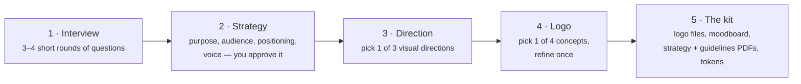
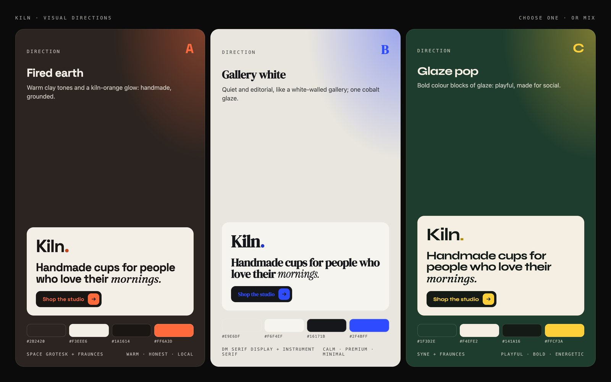
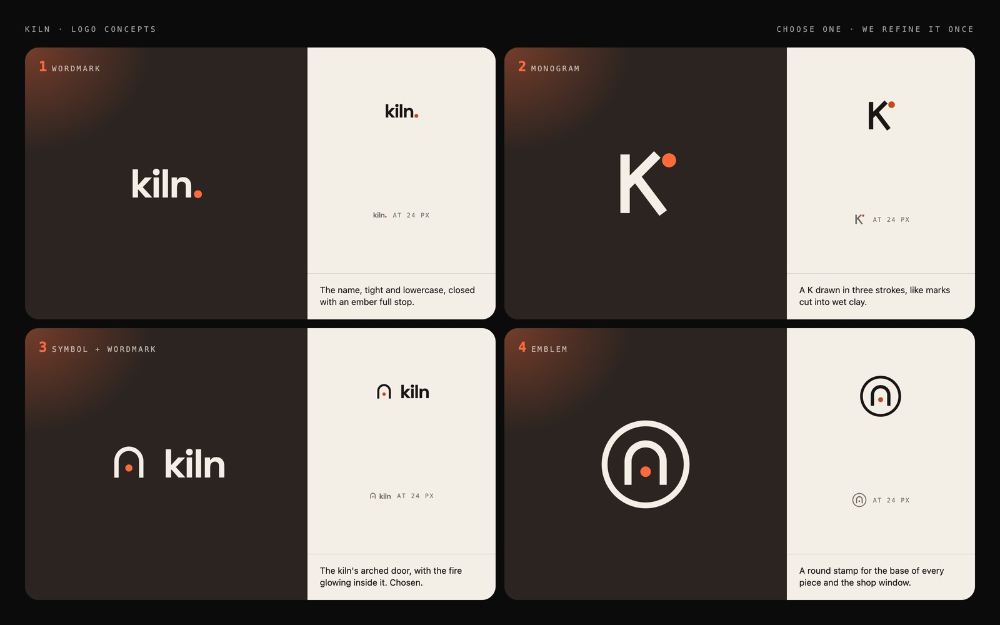
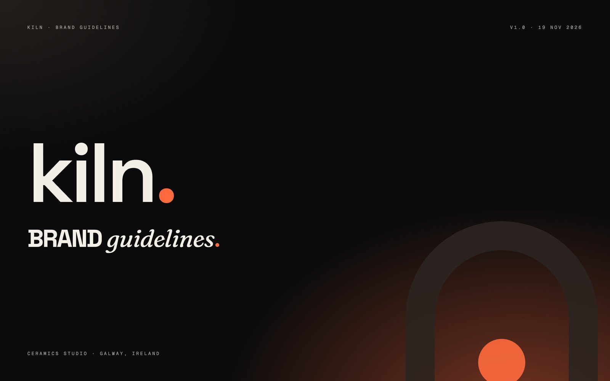

<p align="center">
  
</p>

<h1 align="center">Claude Brand Kit</h1>

<p align="center">
  <b>Four Claude Code skills that turn an idea into a finished brand.</b><br />
  Strategy, logo, moodboard, brand guidelines and design tokens — drawn in code, rendered on your own machine.
</p>

<p align="center">
  <code>/brand-identity</code> · <code>/brand-kit</code> · <code>/moodboard</code> · <code>/logo</code>
</p>

---

## What it does

| Command | For | You get |
|---|---|---|
| **`/brand-identity`** | You have an idea, but no brand yet | Claude interviews you about your vision, goals, audience and personality, writes the strategy, shows you **3 visual directions** and **4 logo concepts** to choose from, then builds the whole kit below |
| **`/brand-kit`** | You already have a name, logo or colours | Logo files, a moodboard, a **10-page brand guidelines PDF**, a cover image, `tokens.css` / `tokens.json` and a README |
| **`/moodboard`** | A quick visual of the brand | A **7-tile moodboard**, 3200 × 2000 PNG |
| **`/logo`** | Logo files for a site, socials or print | Transparent PNGs (for dark and light backgrounds), the monogram, the mark, SVGs and a `favicon.ico` |

Everything is drawn in HTML, CSS and SVG and rendered with the Chrome you
already have. **No image generator, no API keys, no watermarks** — every file it
makes is yours.

## How `/brand-identity` works



Claude asks before it decides. Each round is a handful of multiple-choice
questions (with room for your own answer), and you see every visual as an
image before you choose.

Every image on this page comes from one run of `/brand-identity` for **Kiln**,
a fictional ceramics studio in Galway — the interview answers, the strategy and
the whole kit are in [`skills/brand-kit/examples/kiln`](skills/brand-kit/examples/kiln).

<table>
  <tr>
    <td width="50%"></td>
    <td width="50%"></td>
  </tr>
  <tr>
    <td align="center"><sub>Stage 3 · three visual directions</sub></td>
    <td align="center"><sub>Stage 4 · four logo concepts, each tested at 24 px</sub></td>
  </tr>
</table>

## What the kit looks like

<p align="center"></p>

<p align="center"></p>

<p align="center"></p>

<p align="center"></p>

The brand guidelines cover: the brand and its values · logo · logo use (clear
space, minimum sizes, six don'ts) · colour with **measured WCAG contrast** ·
typography · graphic language · voice ("say it like this / not like this") ·
applications · files and tokens.

## Install

You need [Claude Code](https://claude.com/claude-code), **Node.js 18+** and **Google Chrome**.

```bash
git clone https://github.com/mchine-ltda/claude-brand-kit.git
```

```bash
cd claude-brand-kit && ./install.sh
```

That copies the four skills into `~/.claude/skills/` (available in every
project) and installs their one dependency. Start a new Claude Code session
and type `/brand-identity`.

<details>
<summary><b>Install for one project only</b></summary>

```bash
./install.sh --project /path/to/your/project
```

The skills go into that project's `.claude/skills/` folder, so you can commit
them and share them with your team.
</details>

<details>
<summary><b>Install by hand</b></summary>

```bash
cp -R skills/* ~/.claude/skills/
```

```bash
cd ~/.claude/skills/brand-kit && npm install --omit=dev
```
</details>

<details>
<summary><b>Chrome somewhere else, or on Linux / Windows (WSL)</b></summary>

The render scripts look for Chrome in the usual macOS and Linux places. Point
them at any Chrome or Chromium with:

```bash
export CHROME_PATH="/path/to/chrome"
```
</details>

<details>
<summary><b>Update or remove</b></summary>

Update: `git pull` in the cloned folder, then run `./install.sh` again (your
previous copy is kept in `~/.claude/skills-backup/<date>/`).

Remove:

```bash
rm -rf ~/.claude/skills/{brand-identity,brand-kit,moodboard,logo}
```
</details>

## Use it

```text
/brand-identity
```
Start from zero. Claude asks what you're building, for whom, where it's going,
and how it should feel — then takes it from there.

```text
/brand-kit Kiln, a ceramics studio in Galway — terracotta and cream
/brand-kit https://your-site.com
/moodboard
/logo
```
Inside a website project, the skills read your existing colours, fonts, logo
and live site first, and only ask about what they can't find.

Everything lands in one folder:

```text
kiln-brand/
├── brand-strategy.md            the approved strategy
├── kiln-brand-strategy.pdf      5 pages
├── kiln-brand-guidelines.pdf    10 pages
├── kiln-brand-cover.png
├── moodboard.png / .jpg         3200 × 2000
├── kiln-wordmark-light.png      transparent, for dark backgrounds
├── kiln-wordmark-dark.png       transparent, for light backgrounds
├── kiln-monogram.png / .svg
├── kiln-mark.png / .svg
├── favicon.ico
├── tokens.css / tokens.json
├── brand.json                   every value used, re-run any time
└── *.html                       the editable sources
```

## How it works

```text
skills/
├── brand-identity/   the interview → strategy → direction → logo flow
├── brand-kit/
│   ├── SKILL.md
│   ├── templates/    moodboard · logo · brandbook · directions · concepts · strategy
│   ├── scripts/      fill.mjs · render.mjs · capture.mjs · palette.mjs
│   └── examples/     Kiln: a complete run, from interview answers to brand.json
├── moodboard/        shortcut to brand-kit's moodboard
└── logo/             shortcut to brand-kit's logo export
```

1. Claude gathers the brand into a `brand.json` (name, palette, fonts, the mark as SVG, the words).
2. `fill.mjs` drops those values into the HTML templates and refuses to continue if anything is missing.
3. `render.mjs` opens the page in headless Chrome and saves PNGs, JPGs and PDFs at 2×.
4. `palette.mjs` measures every colour pair, so the contrast numbers in the guidelines are real.
5. Claude **looks at every image** before showing you, and fixes overlaps or clipped words first.

### The house style

The templates share one look: a near-black backdrop, rounded tiles, a quiet
base colour, a light that is never pure white, an ink that is never pure
black, and **one loud accent that glows**. Headlines say who the brand is for
and the outcome — never an empty slogan — with one word in a serif italic,
closed by an accent-coloured dot. Change the templates to make the style your
own.

## FAQ

**Does it use AI image generation?** No. Every mockup — the billboard, the hang
tag, the phone, the mug — is drawn in CSS and SVG. That's why the files are
yours, and why it needs no account or API key.

**What about fonts?** It defaults to free Google Fonts (SIL Open Font Licence).
If you use a paid font, put the licensed files in the kit's `assets/` folder;
they are never bundled or shared.

**Can I get photo-real mockups?** Not from this kit. Use the moodboard and
logo files as the brief for a photographer or an image tool.

**Does it make up facts about my business?** It's told not to: no invented
clients, numbers, reviews or history. The strategy states intentions, and
anything unknown is listed as a placeholder for you to fill.

---

<p align="center">
  Made by <a href="https://mchine.vercel.app">MCHINE</a> · web design and development, Dublin.<br />
  <sub>Code under the MIT licence. Kiln is a fictional brand made for this demo.</sub>
</p>
